# LGPrivacyShield

### Make your LG TV’s privacy controls easier to see and manage.

See Live Plus and voice status, adjust the controls your TV supports, and save settings to restore later.

## Contents

- [Screenshots](#screenshots)
  - [Overview](#overview)
  - [Controls](#controls)
  - [LG agreements](#lg-agreements)
  - [About](#about)
- [Local operation and privacy](#local-operation-and-privacy)
- [Expected TV support](#expected-tv-support)
- [Compatibility feedback](#compatibility-feedback)
- [Install and help](#install-and-help)

## Screenshots

Click an image to enlarge. Dark mode is the default, and your light-theme choice is saved on the TV.

### Overview

Check TV software, Live Plus and voice status. **Review controls** opens supported settings.

<a href="docs/screenshots/overview-dark.png">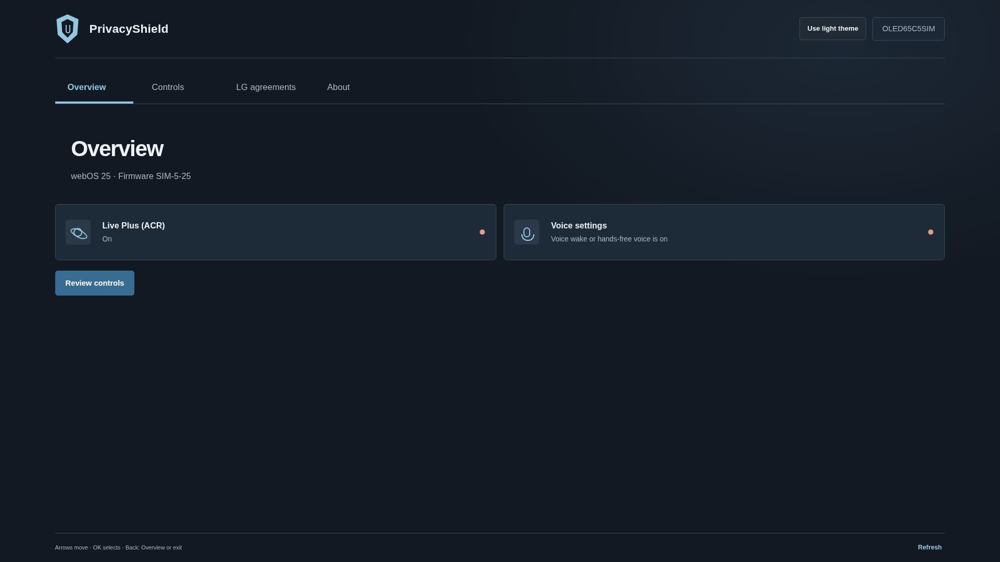</a> <a href="docs/screenshots/overview-light.png">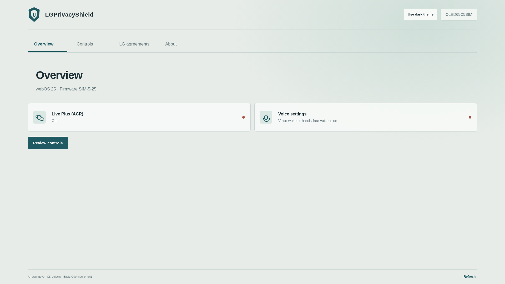</a>

### Controls

Apply recommended settings or adjust switches. Save readable settings for later; if you have no saved point, the first change saves the starting values. Changes are checked on the TV.

The top shows actions and first settings. Scroll down for the rest and your position in the list.

<a href="docs/screenshots/controls-top-dark.png">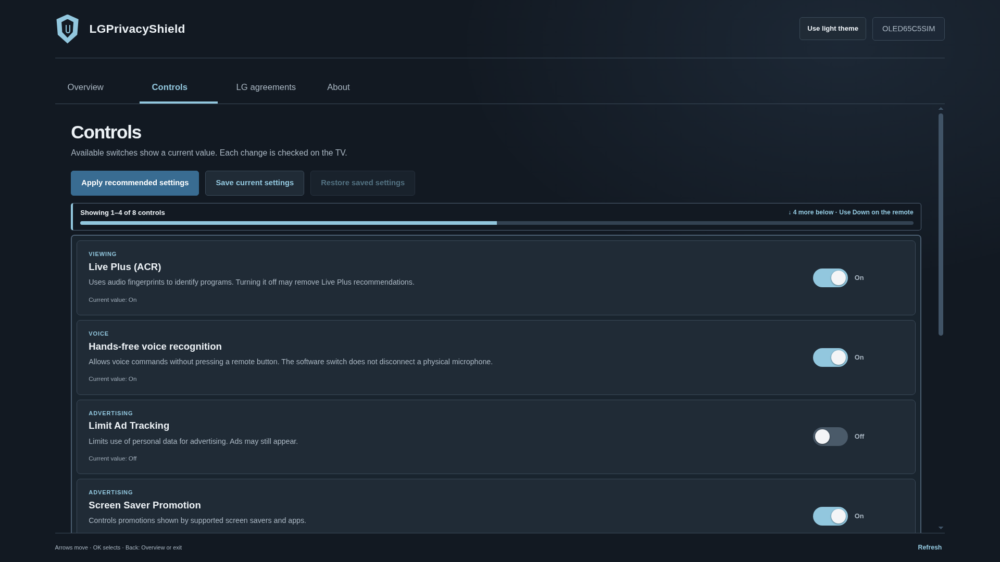</a> <a href="docs/screenshots/controls-top-light.png">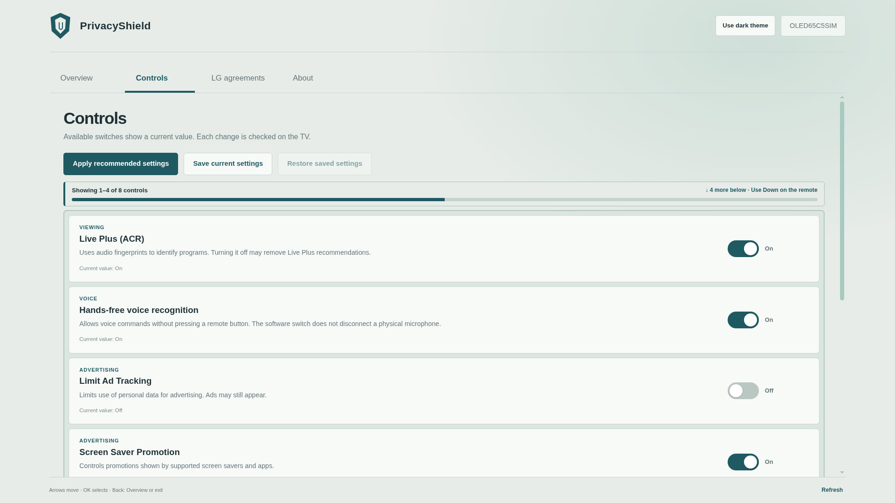</a>

<a href="docs/screenshots/controls-bottom-dark.png">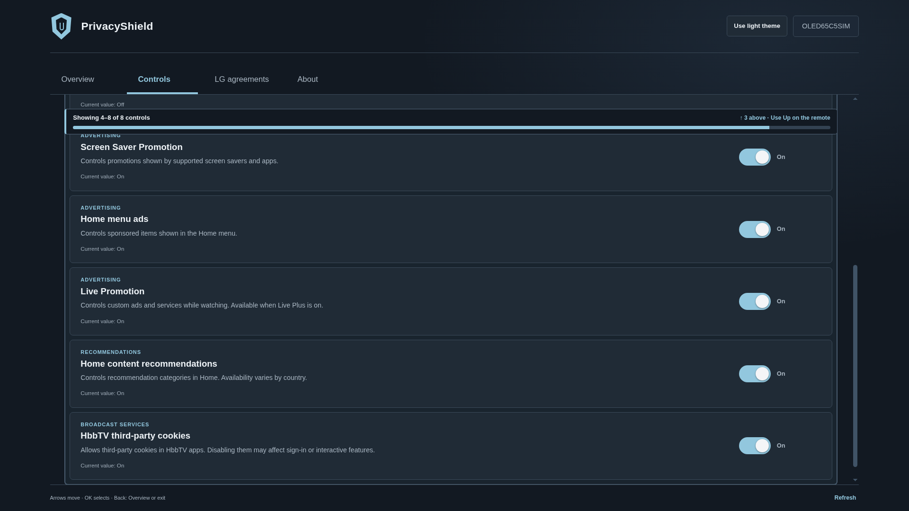</a> <a href="docs/screenshots/controls-bottom-light.png">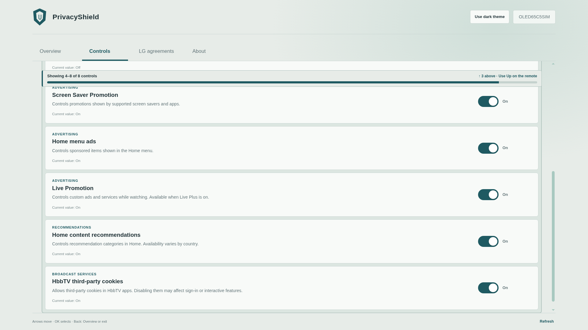</a>

### LG agreements

Review saved choices and their documented effects. Open LG User Agreements to change them.

<a href="docs/screenshots/agreements-top-dark.png">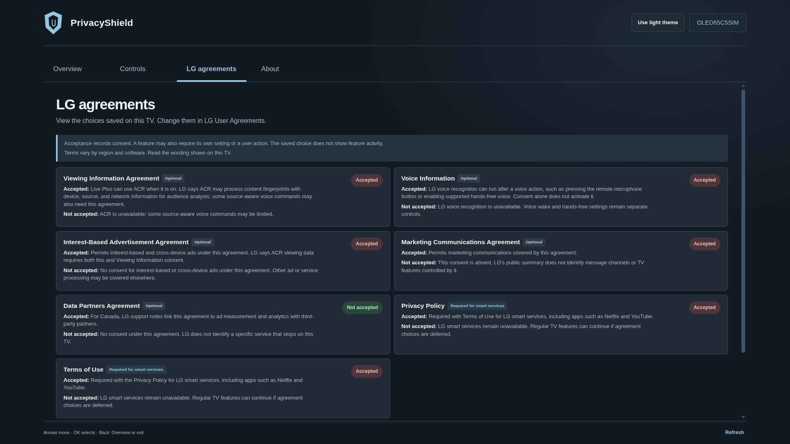</a> <a href="docs/screenshots/agreements-top-light.png">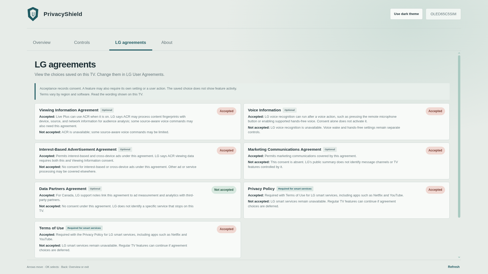</a>

 <a href="docs/screenshots/agreements-bottom-light.png">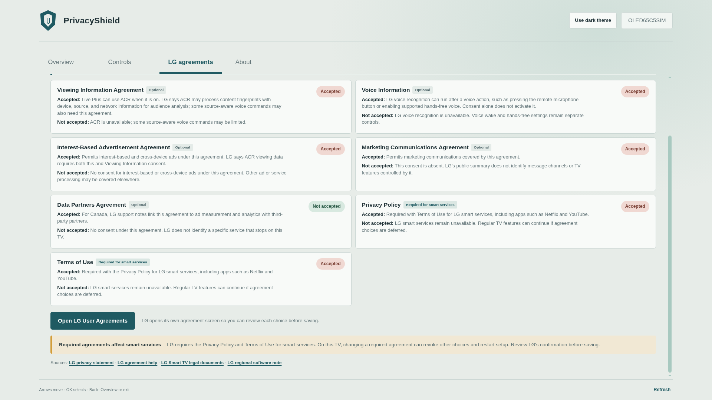</a>

### About

Find the app version, license and source code, plus the support QR code and [Ko-fi link](https://ko-fi.com/snapetech).

<a href="docs/screenshots/about-dark.png">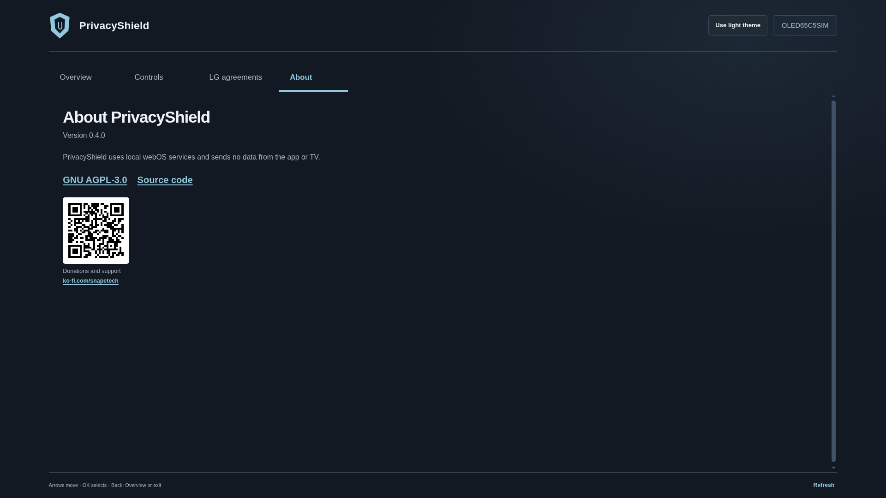</a> <a href="docs/screenshots/about-light.png">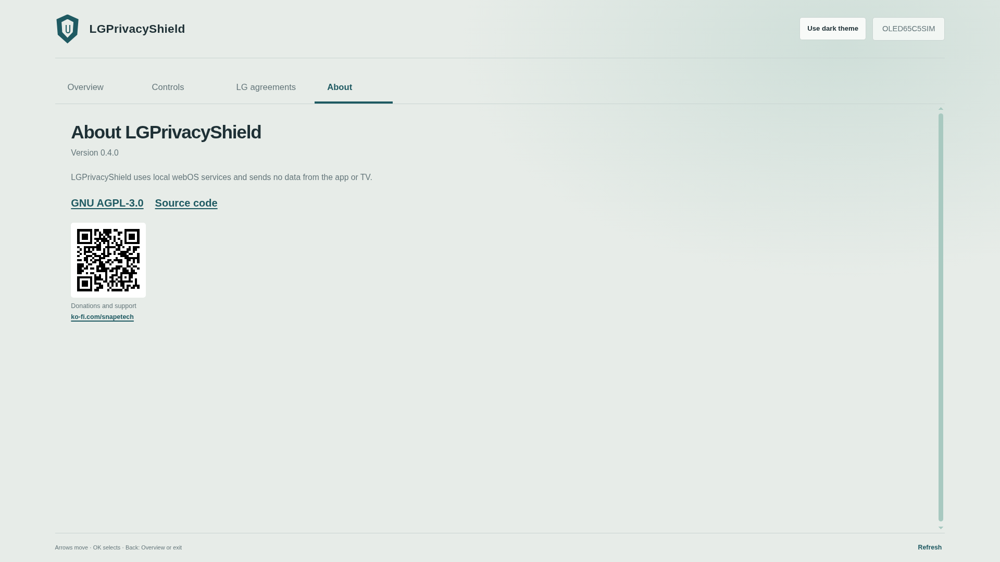</a>

## Local operation and privacy

**Local-first:** LGPrivacyShield runs on your TV and uses local webOS services. The app sends no data during normal use.

The app does not record audio or screenshots, run a background service, inspect encrypted network traffic, or upload TV settings or viewing activity. Network destination history requires separate router or DNS logs. A software voice switch does not disconnect a physical microphone if the TV does not expose a verified microphone-disconnect control to this app.

The TV's system software and other apps may still use the network. LGPrivacyShield does not monitor or block their traffic. See the [security notes](SECURITY.md) for the app's trust boundary and review limits.

## Expected TV support

We expect LGPrivacyShield to support every LG OLED model family B1–B6, C1–C6, and G1–G6 on webOS 6.x and webOS 22, 23, 24, 25, or 26. That puts all 18 families in scope for each listed webOS version, including versions later than a model's launch version.

| TV generation | OLED model families | Launch webOS |
|---|---|---|
| 2021 | B1, C1, G1 | 6.x |
| 2022 | B2, C2, G2 | 22 |
| 2023 | B3, C3, G3 | 23 |
| 2024 | B4, C4, G4 | 24 |
| 2025 | B5, C5, G5 | 25 |
| 2026 | B6, C6, G6 | 26 |

The table shows each family's launch webOS version. The app selects its settings map using the TV's family and installed webOS version, so an updated TV uses its current software profile. Available controls vary by model, region, firmware, and Homebrew access. A setting appears only when the TV returns a recognized current value, and changes are verified by reading the requested value back. Physical TV testing has been on one C6 (`OLED77C6HUP`) running webOS 26 (firmware `43.21.79`). See the [model compatibility maps](docs/DEVICE-COMPATIBILITY.md) for details.

## Compatibility feedback

If a model is missing or a control cannot be read, choose **Prepare compatibility report** in Controls and scan the QR code. Scanning opens GitHub's compatibility form with a report prefilled in the link; submitting the form creates a public issue for maintainers to review. The report includes the TV model, software and firmware, profile and service access, and whether each of the 17 controls could be read. It excludes current setting values and LG agreement choices.

Owners can add the TV's region or a menu-path observation before submitting. These reports give maintainers feedback across models, software versions, and regions so we can spot coverage gaps and improve the model maps.

## Install and help

Install the [latest release](https://github.com/snapetech-org/LGPrivacyShield/releases/latest) with [webOS Dev Manager](https://github.com/webosbrew/dev-manager-desktop). Homebrew Channel on a rooted TV enables local setting access.

See the [installation guide](docs/TEST-ON-YOUR-TV.md), [setting effects](docs/FEATURE-IMPACT.md), [LG agreement effects](docs/LG-AGREEMENT-EFFECTS.md), and [model compatibility](docs/DEVICE-COMPATIBILITY.md).

## License

LGPrivacyShield is licensed under the GNU Affero General Public License, version 3. See [LICENSE](LICENSE).
