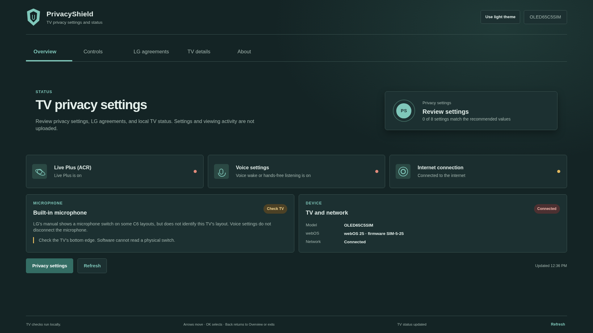
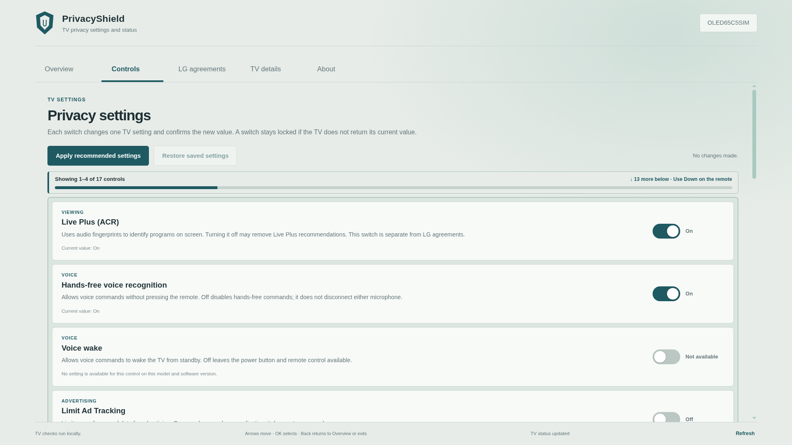
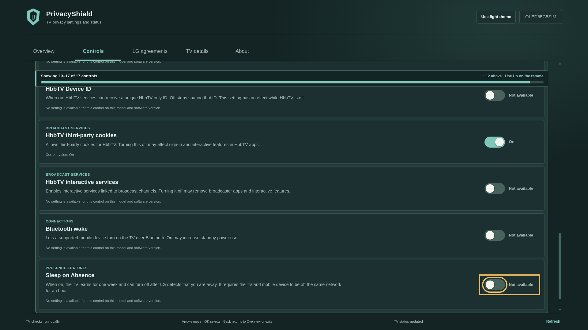
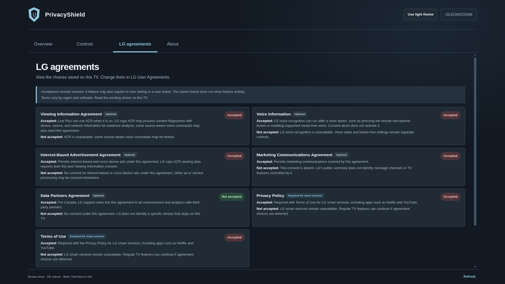
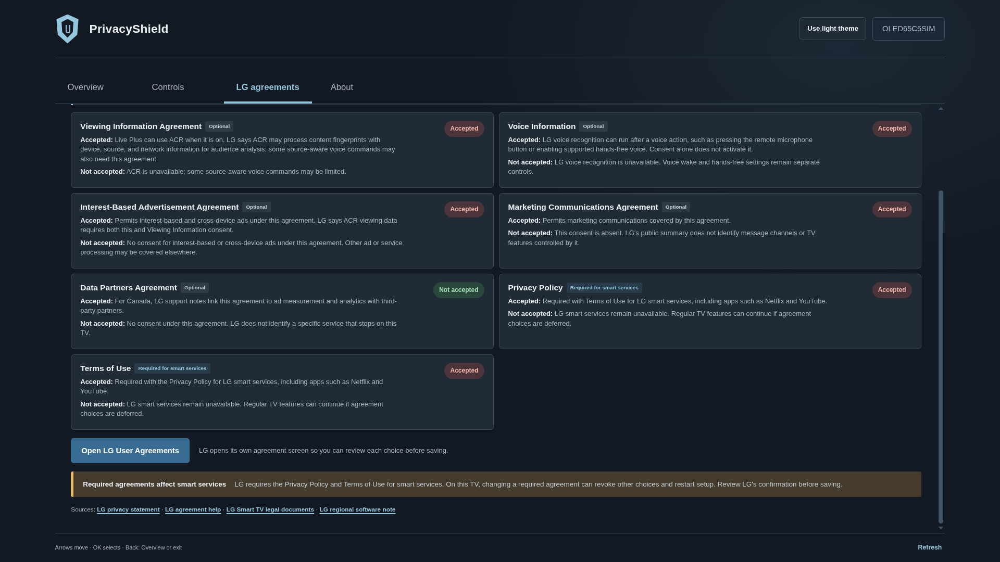
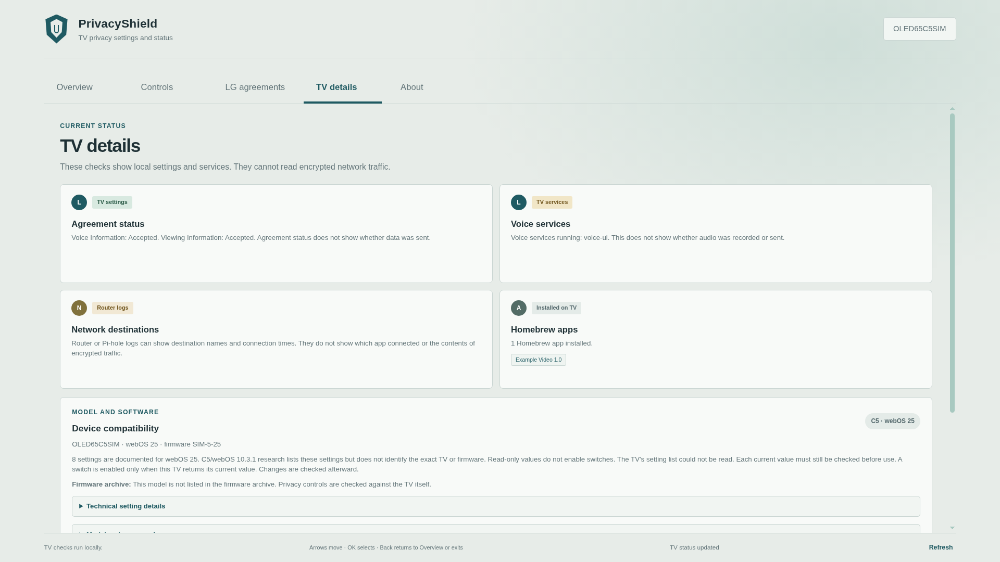
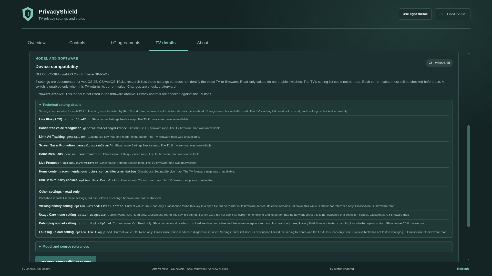
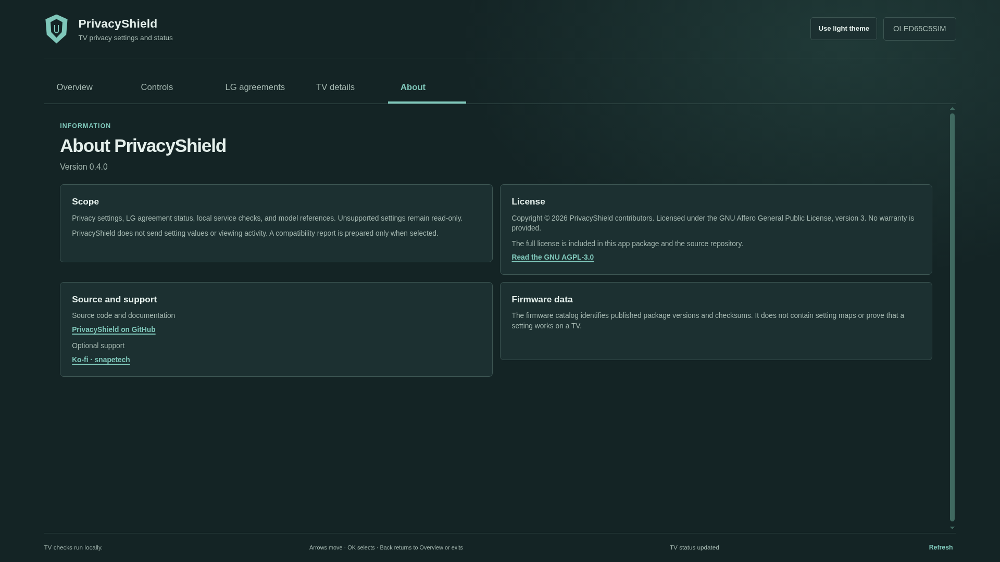

# PrivacyShield app guide

## Contents

- [Screenshots](#screenshots)
- [Overview](#overview)
- [Controls](#controls)
- [LG agreements](#lg-agreements)
- [TV details](#tv-details)
- [About](#about)
- [Navigation and setting changes](#navigation-and-setting-changes)

This guide describes the app screens in the current source. Install steps are in
the [TV guide](TEST-ON-YOUR-TV.md); the [documentation index](README.md) links to
the setting, model, and developer references.

## Screenshots

These 1920×1080 captures were rendered in headless Chromium with synthetic
webOS service responses. The sample identity and values are test data, not a
live TV or a report of model support. The thumbnails open the full-size PNGs.

## Overview

The Overview page summarizes Live Plus and voice settings, internet connection,
microphone guidance, and the TV's model and software. Use **Privacy settings**
to open Controls or **Refresh** to read the TV again.

## Controls

Controls lists 17 candidates in groups for viewing, voice, advertising,
recommendations, broadcast services, connections, and presence. The TV decides
which current values it exposes. PrivacyShield leaves a switch unavailable when
it cannot read a supported `on` or `off` value, then reads the setting again
after each change.

**Apply recommended settings** applies the profile's recommended values to
readable controls. PrivacyShield stores the readable starting values locally
before the first change; **Restore saved settings** applies that snapshot.
Do Not Sell, Smart Tips, HbbTV cookies and interactive services, Bluetooth
wake, and Sleep on Absence remain separate choices.

The counter and progress bar show the visible range in the list. Use Up and
Down on the remote to move through all controls, including unavailable rows.

## LG agreements

The page shows the saved choice reported by the TV and summaries of documented
accepted and declined effects. The required Privacy Policy and Terms of Use are
identified separately from optional agreements. Additional TV-reported
agreements appear with an unmapped-effect note when their effects have not been
verified.

Choose **Open LG User Agreements** to make a change in LG's native screen. The
page refreshes the saved status when you return.

## TV details

TV details groups several kinds of local information: agreement status, listed
voice services, installed Homebrew apps, diagnostic-upload settings, and model
compatibility. Router or DNS logs are needed to identify network destinations.

Device compatibility shows the model and installed software profile, the
settings mapped for that profile, and any source-backed read-only findings.
Expand **Technical setting details** to inspect mapped setting names and source
notes. The compatibility report includes model/software identity and yes/no
setting read-access results; it does not include current setting values or
agreement choices. Use it when your model/software is unmapped or controls
remain read-only. The single QR code opens GitHub's report form with the JSON
pre-filled. Opening the link sends the report to GitHub in the URL; submitting
the form posts it as an issue for maintainers to review.

## About

About shows the source version, app scope, license, source repository, support
link, and what the firmware catalog contains.

## Navigation and setting changes

Use the remote's arrow keys to move between tabs, controls, and buttons. Press
OK to select or toggle; Back returns to Overview, then exits the app. Privacy
settings are read from the TV. The app reports a change as successful only
after reading the new value back.

Availability varies by model, region, webOS version, firmware, and Homebrew
permissions. See [model compatibility](DEVICE-COMPATIBILITY.md) for profiles
and evidence, or [privacy setting effects](FEATURE-IMPACT.md) for the documented
effect of each control.
